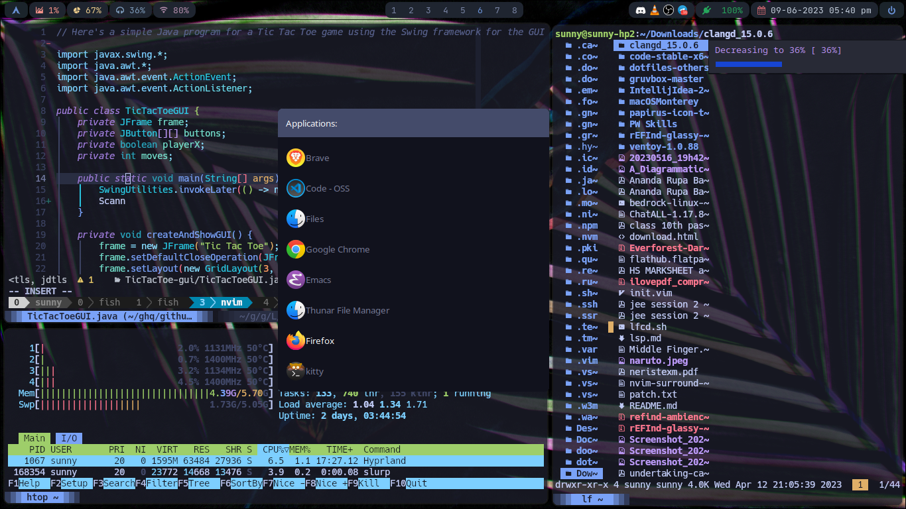
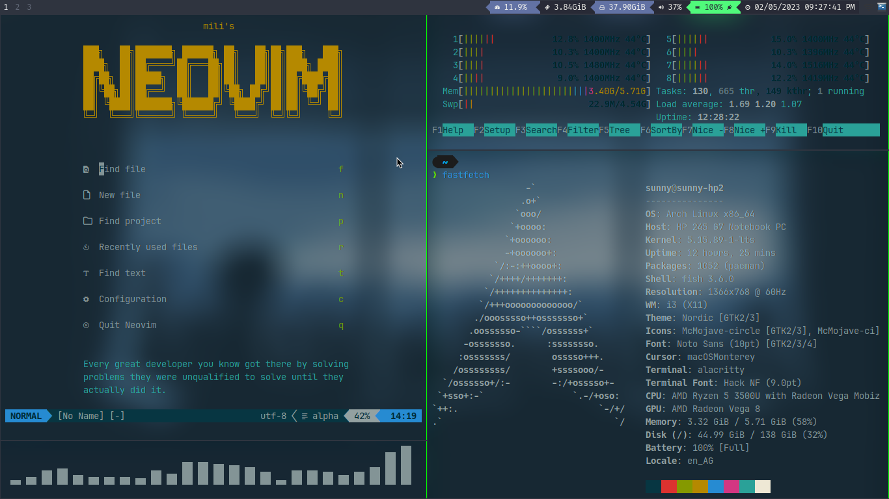

# 🐧 Linux Dotfiles

Modular, high-performance dotfiles tailored for Arch Linux and modern Linux systems, managed with [GNU Stow](https://www.gnu.org/software/stow/).

> 🔗 **Other Branches**:
> - 🍎 **[macOS Branch](https://github.com/LegioN2004/dotfiles/tree/macos)** — Ghostty, pure Zsh & Fish (8ms), Raycast sleep/wake automation, Apple Silicon setup.
> - 🏠 **[Main Branch](https://github.com/LegioN2004/dotfiles/tree/main)** — Legacy root branch.

---

## ⚡ What's Included

| Component | Description |
| :--- | :--- |
| **Window Managers** | • **Wayland**: [Hyprland](https://hyprland.org/) + [Waybar](https://github.com/Alexays/Waybar)<br>• **X11**: [i3wm](https://i3wm.org/) + [Polybar](https://github.com/polybar/polybar) + [Picom](https://github.com/yshui/picom) |
| **Terminal** | [Kitty](https://sw.kovidgoyal.net/kitty/) — Fast, GPU-rendered terminal (`kitty/.config/kitty/kitty.conf`). |
| **Shells** | • **Fish**: Sub-10ms startup, native `abbr` abbreviations for Pacman/Paru, systemd power shortcuts (`sus`, `pow`, `reb`), and Git.<br>• **Zsh**: Zero-framework DIY setup (Option A) with daily cached `compinit`, Linuxbrew paths, and standalone Git aliases. |
| **App Launcher & Notifications** | [Rofi](https://github.com/davatorium/rofi) launcher / window switcher and [Dunst](https://dunst-project.org/) notification daemon. |
| **Editor & Multiplexer** | [Neovim](https://neovim.io/) with LSP/Mason configuration, [Tmux](https://github.com/tmux/tmux) with sessionizer. |
| **CLI Tools** | [Lazygit](https://github.com/jesseduffield/lazygit), [Btop](https://github.com/aristocratos/btop), [Ranger](https://github.com/ranger/ranger), [Eza](https://github.com/eza-community/eza), [Zoxide](https://github.com/ajeetdsouza/zoxide). |

---

## 📸 Screenshots

### Hyprland Rice


### i3wm Rice


---

## 🚀 Setup on a New Linux Machine

### 1. Prerequisites (Arch Linux)

Install Git, GNU Stow, shells, and essential tools:

```bash
# Core base tools
sudo pacman -S --needed git stow base-devel

# Shells, Terminal & CLI Utilities
sudo pacman -S --needed fish zsh kitty neovim tmux lazygit btop eza zoxide

# (Optional) Aur helper for paru / yay if not installed
```

### 2. Clone the Repository

Clone the `linux` branch directly to `~/dotfiles`:

```bash
git clone -b linux git@github.com:LegioN2004/dotfiles.git ~/dotfiles
cd ~/dotfiles
```

### 3. Symlink Configurations with GNU Stow

Use `stow` to symlink desired components into your home directory:

```bash
# 1. Shells & Terminal
stow zsh
stow fish
stow kitty

# 2. Editors & Tools
stow nvim
stow tmux
stow lazygit
stow btop

# 3. Desktop Environment / Window Managers
# For Hyprland (Wayland):
stow hyprland waybar rofi dunst

# For i3wm (X11):
stow i3 polybar picom rofi dunst sxhkd
```

> [!TIP]
> If a configuration file already exists in your home directory (e.g., an existing `~/.bashrc` or `~/.zshrc`), back it up or delete it before running `stow`.

---

## ⌨️ Useful Linux Shell Shortcuts (`abbr`)

Both Fish and Zsh come preconfigured with lightweight, zero-latency abbreviations:

| Category | Shortcut | Expands To |
| :--- | :--- | :--- |
| **Pacman / Paru** | `sps <pkg>`<br>`spsy`<br>`pr <pkg>`<br>`clean` | `sudo pacman -S <pkg>`<br>`sudo pacman -Syu`<br>`paru -Rns <pkg>`<br>`sudo pacman -Rns (pacman -Qtdq)` |
| **System Power** | `sus`<br>`pow`<br>`reb`<br>`hib` | `systemctl suspend`<br>`systemctl poweroff`<br>`systemctl reboot`<br>`systemctl hibernate` |
| **Configs** | `hyprlconfig`<br>`i3config`<br>`kittyconfig`<br>`waybarconf` | Directly opens corresponding config in `$EDITOR` |
| **Git** | `gst`<br>`gco`<br>`ga`<br>`gcmsg` | `git status`<br>`git checkout`<br>`git add`<br>`git commit -m` |

---

## 🛠️ Maintenance & Tips

- **Edit Dotfiles**: Edit files directly in `~/dotfiles/`. Since they are symlinked with Stow, changes are instantly active.
- **Push Updates**:
  ```bash
  cd ~/dotfiles
  git add .
  git commit -m "update: tweak configuration"
  git push origin linux
  ```
